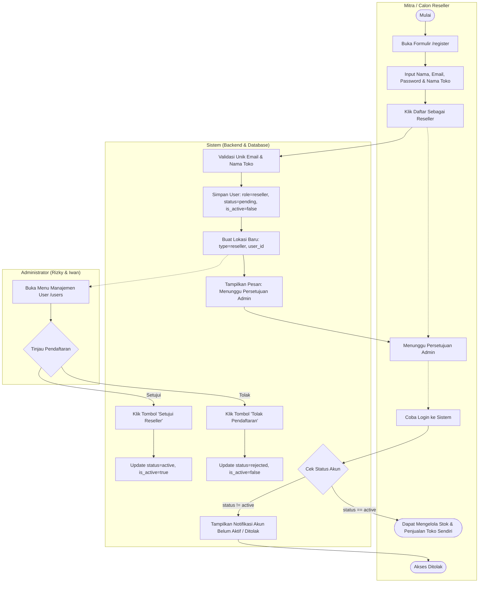
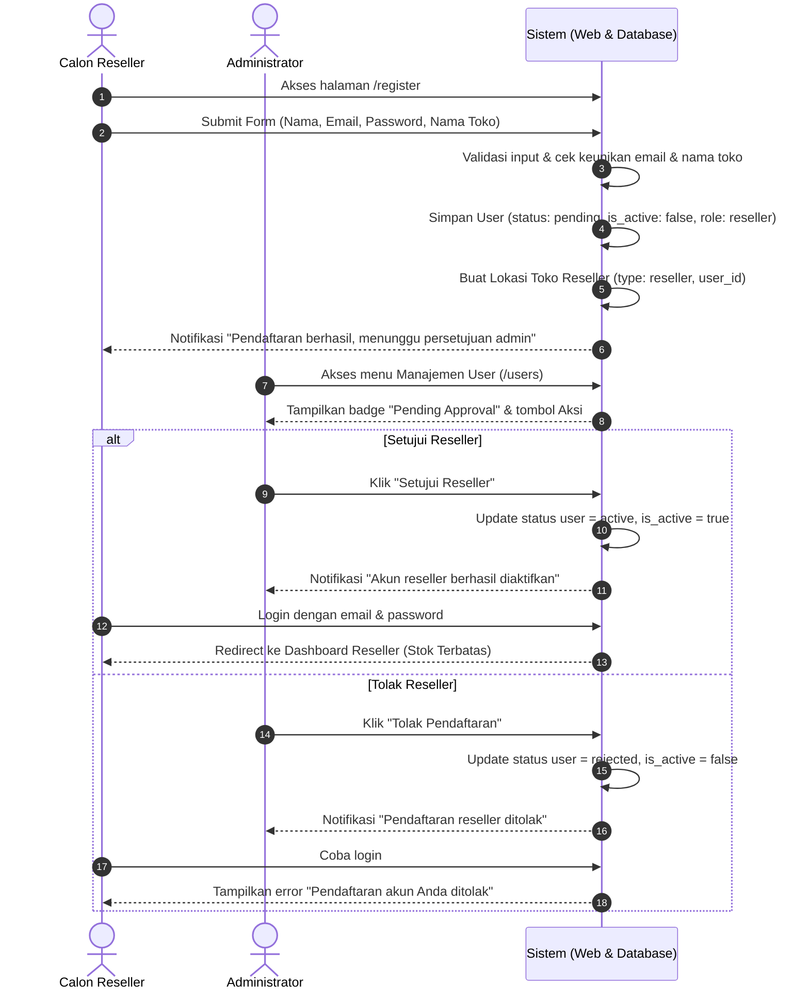
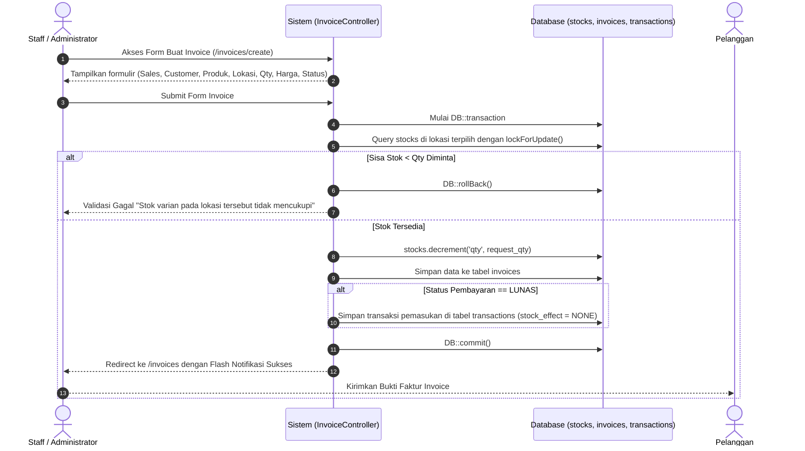
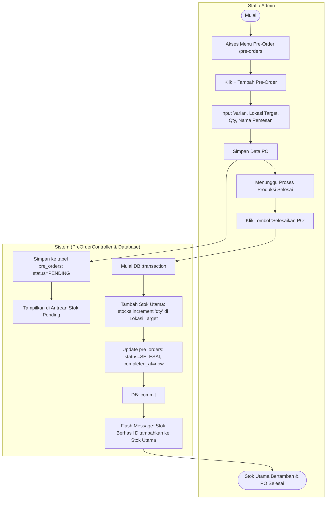
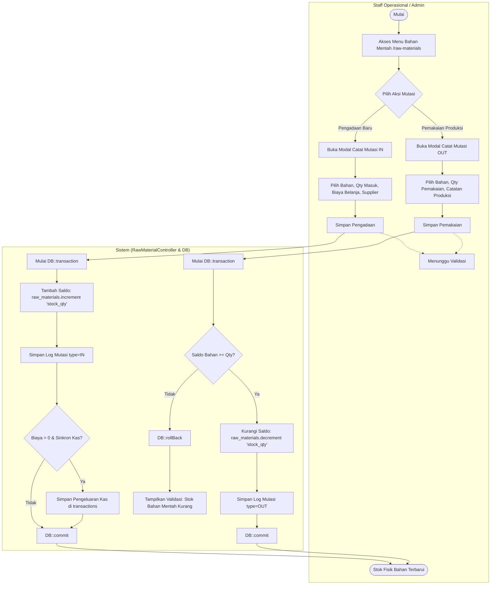

# Activity Diagram & Alur Proses Bisnis — Scentpeep Management System

Dokumentasi diagram aktivitas (*Activity Diagram* dengan swimlane per aktor) dan diagram sekuensial (*Sequence Diagram* interaksi sistem) yang mencerminkan alur operasional aktual pada sistem.

---

## 1. Alur Registrasi & Persetujuan Reseller

### 1.1 Activity Diagram (Swimlane per Aktor)



### 1.2 Sequence Diagram Interaksi



---

## 2. Alur Penerbitan Invoice & Pemotongan Stok Atomik

### 2.1 Activity Diagram (Swimlane per Aktor)

```mermaid
flowchart TD
    subgraph Lane_User ["Pengguna (Admin / Staff)"]
        U_Start([Mulai]) --> U_Form[Buka Form Buat Invoice /invoices/create]
        U_Form --> U_Fill[Pilih Sales: RIZKY/IWAN/VANNY, Pelanggan, Varian Parfum, Lokasi Asal, Qty, Total Harga, Status Pembayaran]
        U_Fill --> U_Submit[Klik Simpan & Terbitkan Invoice]
        U_Submit -.-> U_Wait[Menunggu Proses Transaksional]
        U_Success([Invoice Terbit & Stok Berkurang])
        U_Failed([Gagal: Stok Fisik Tidak Mencukupi])
    end

    subgraph Lane_Sistem ["Sistem (InvoiceController & Database)"]
        U_Submit --> S_TxBegin[Mulai DB::transaction]
        S_TxBegin --> S_Lock[Query Stok di Lokasi dengan lockForUpdate]
        S_Lock --> S_Check{Stok Tersedia >= Qty?}
        
        S_Check -->|Ya| S_Dec[Kurangi Stok: stocks.decrement 'qty']
        S_Dec --> S_SaveInv[Simpan Baris Invoice di tabel invoices]
        S_SaveInv --> S_CheckPaid{Status == LUNAS?}
        S_CheckPaid -->|Ya| S_SyncCash[Catat Transaksi Kas Masuk di transactions]
        S_CheckPaid -->|Tidak| S_SkipCash[Lewati Kas Masuk (Piutang Usaha)]
        S_SyncCash --> S_Commit[DB::commit]
        S_SkipCash --> S_Commit
        S_Commit --> S_SuccNotif[Redirect ke Daftar Invoice & Notifikasi Sukses]
        S_SuccNotif --> U_Success

        S_Check -->|Tidak| S_Rollback[DB::rollBack]
        S_Rollback --> S_ErrNotif[Kembalikan Validasi: Stok Tidak Cukup]
        S_ErrNotif --> U_Failed
    end
```

### 2.2 Sequence Diagram Interaksi



---

## 3. Alur Pre-Order (PO) & Penyelesaian ke Stok Utama

### 3.1 Activity Diagram



---

## 4. Alur Transfer Stok Multi-Lokasi (Full CRUD Atomik)

### 4.1 Activity Diagram


---

## 5. Alur Pengadaan & Pemakaian Bahan Mentah Packaging

### 5.1 Activity Diagram



---

## 6. Alur Pembukuan Kas Operasional Murni

### 6.1 Activity Diagram


