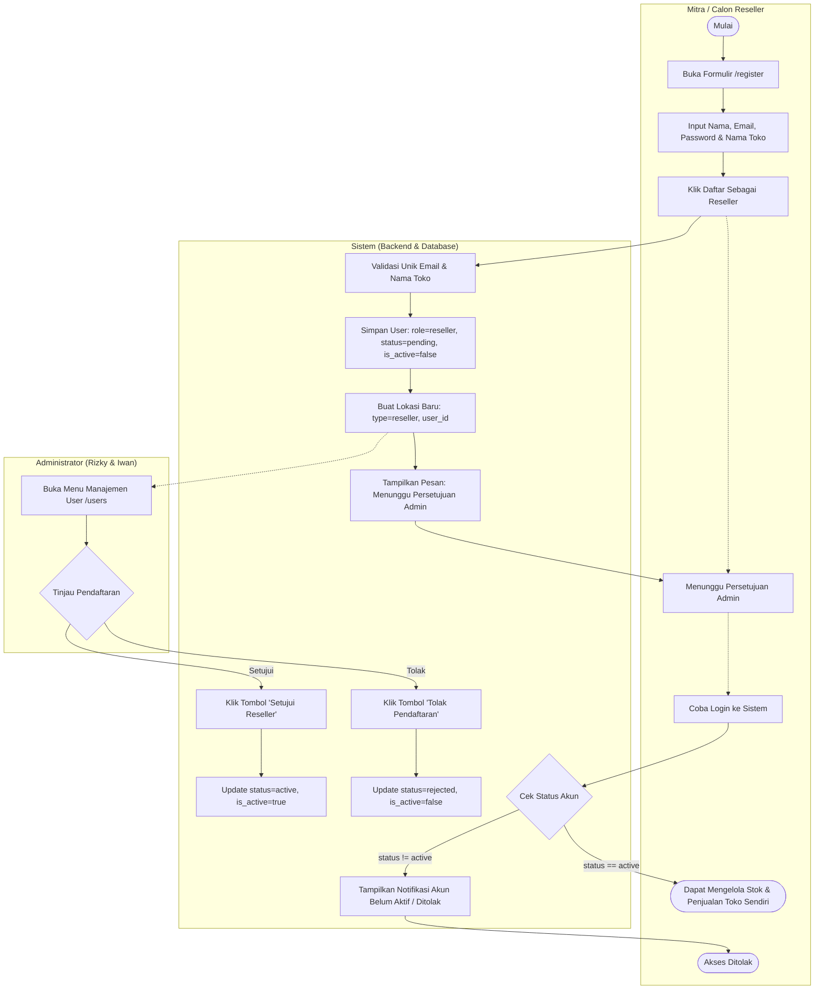
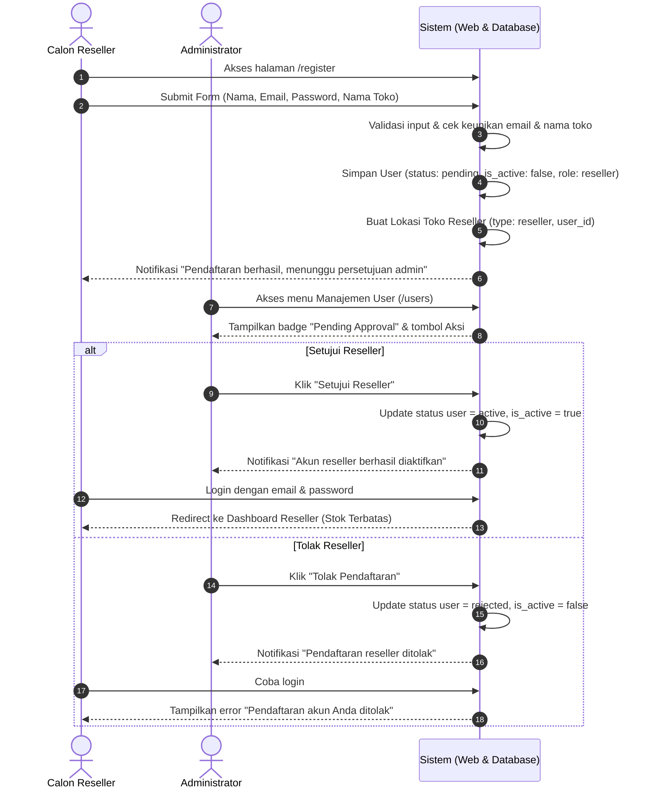
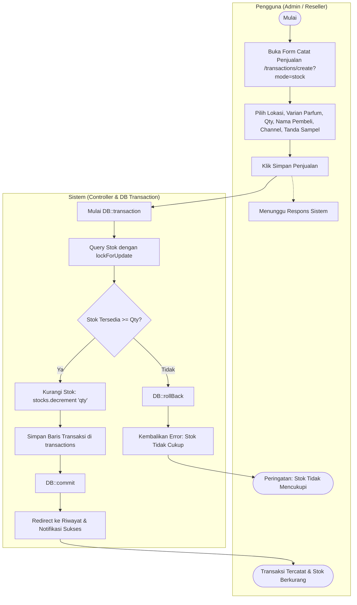
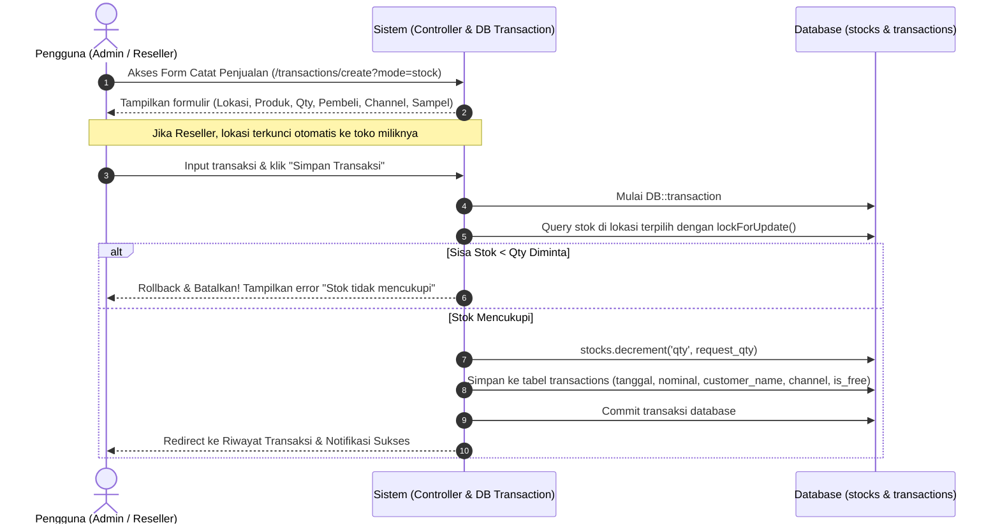
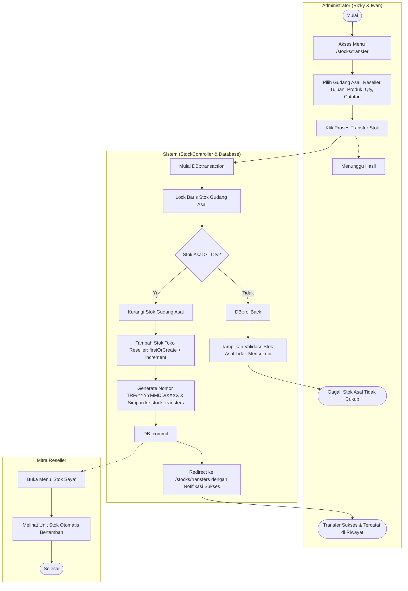
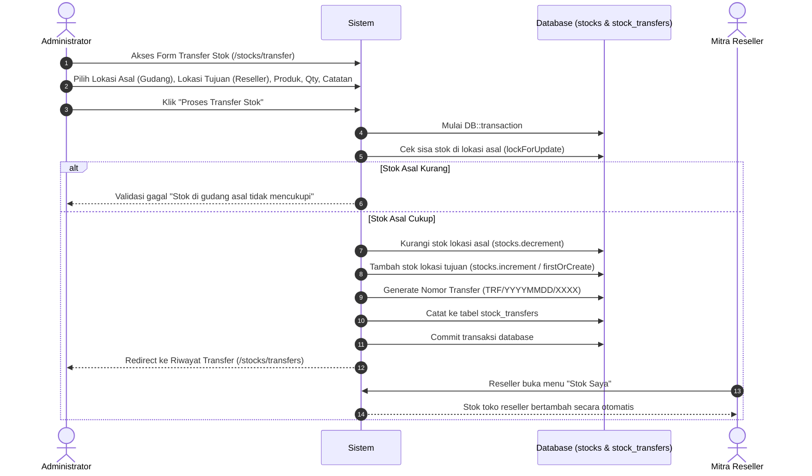

# Activity Diagram & Alur Proses Bisnis — Scentpeep Management System

Dokumentasi diagram aktivitas (swimlane per aktor) dan sequence diagram interaksi sistem, diturunkan langsung dari kode akhir sistem.

---

## 1. Alur Registrasi & Persetujuan Reseller

### 1.1 Activity Diagram (Swimlane per Aktor)

### 1.2 Sequence Diagram Interaksi

---

## 2. Alur Pencatatan Penjualan & Pemotongan Stok Atomik

### 2.1 Activity Diagram (Swimlane per Aktor)

### 2.2 Sequence Diagram Interaksi

---

## 3. Alur Transfer Stok dari Gudang ke Reseller (Admin Only)

### 3.1 Activity Diagram (Swimlane per Aktor)

### 3.2 Sequence Diagram Interaksi

