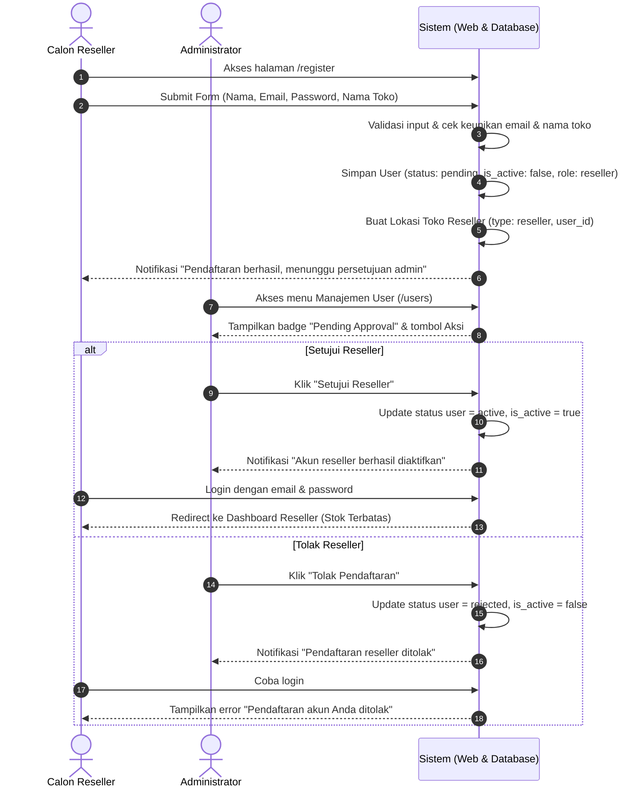
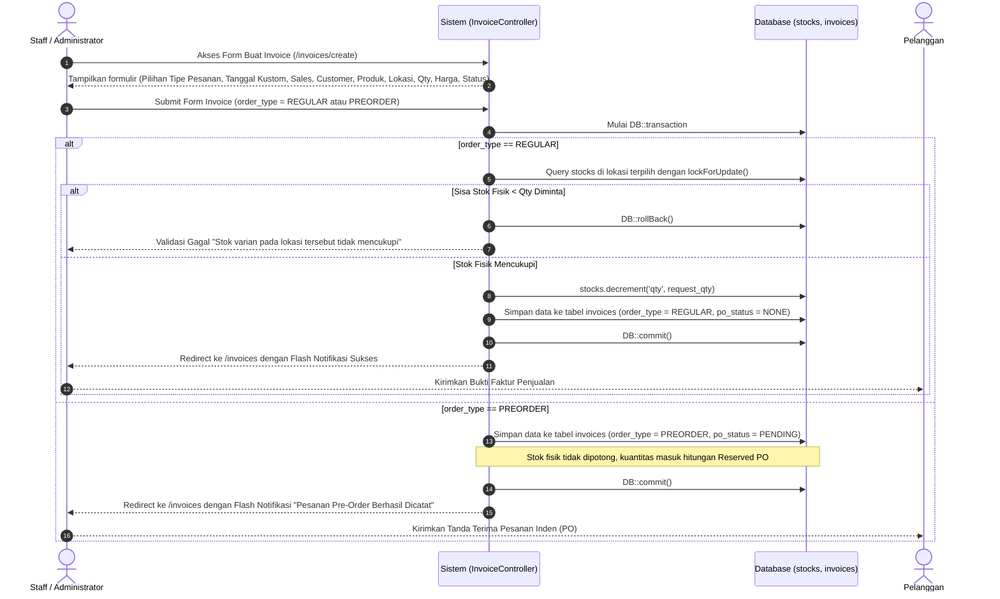
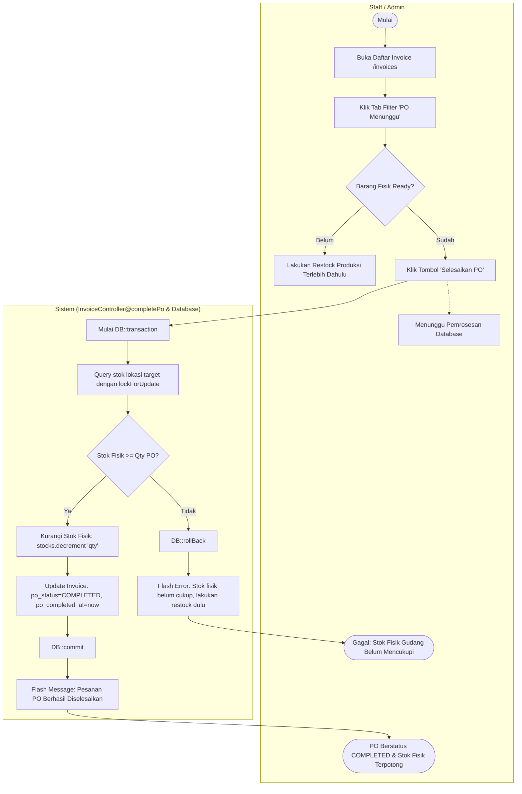
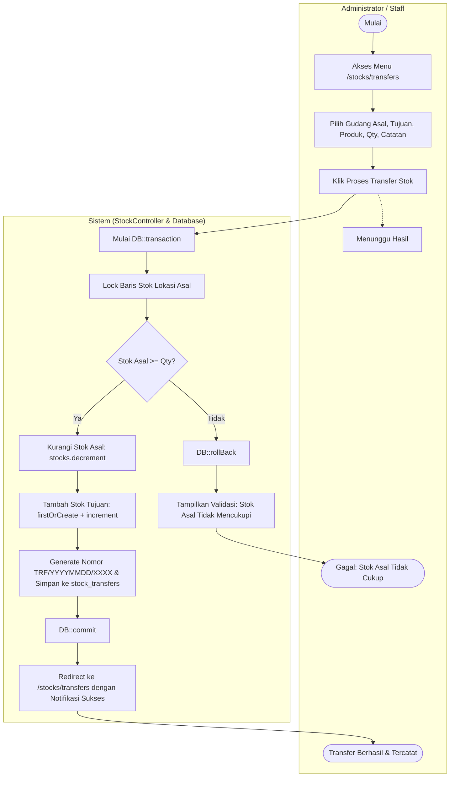
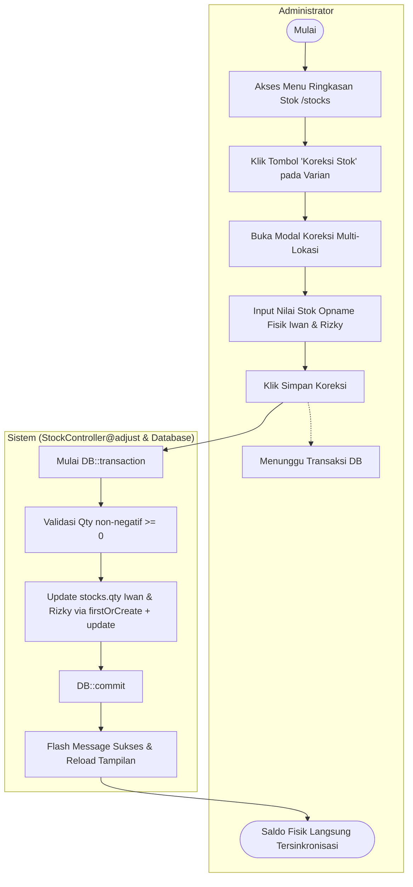
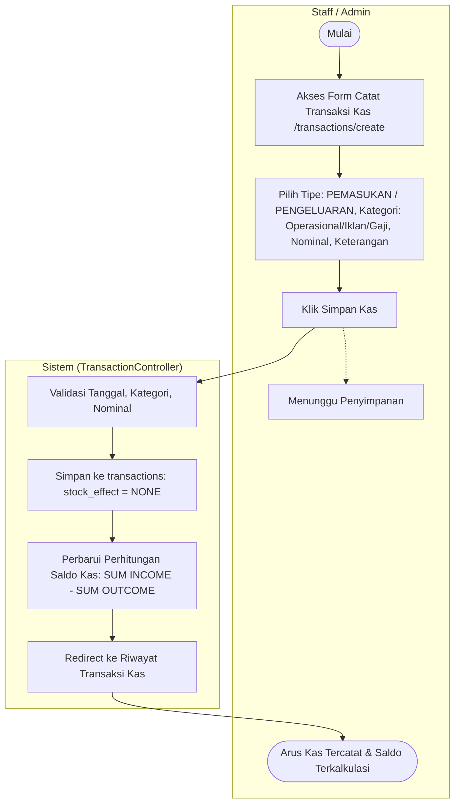
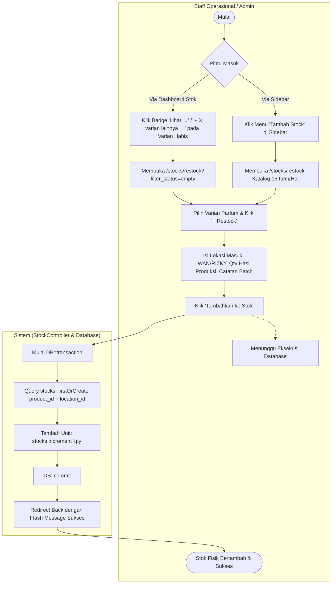
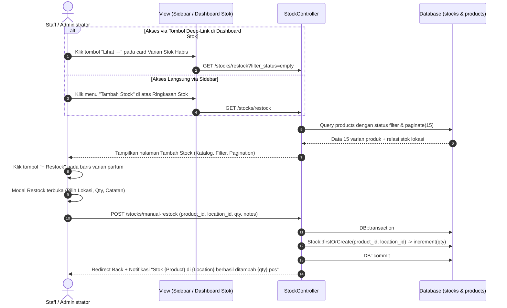

# Activity Diagram & Alur Proses Bisnis — Scentpeep Management System

Dokumentasi diagram aktivitas (*Activity Diagram* dengan swimlane per aktor) dan diagram sekuensial (*Sequence Diagram* interaksi sistem) yang mencerminkan alur operasional aktual pada sistem per rilis **v3.2**.

---

## 1. Alur Registrasi & Persetujuan Reseller

### 1.1 Activity Diagram (Swimlane per Aktor)


### 1.2 Sequence Diagram Interaksi



---

## 2. Alur Penerbitan Invoice Penjualan (Reguler vs Pre-Order)

### 2.1 Activity Diagram (Swimlane per Aktor)

```mermaid
flowchart TD
    subgraph Lane_User ["Pengguna (Admin / Staff)"]
        U_Start([Mulai]) --> U_Form[Buka Form Buat Invoice /invoices/create]
        U_Form --> U_Fill[Pilih Tipe Pesanan: REGULAR / PREORDER, Tanggal Transaksi, Sales, Pelanggan, Varian Parfum, Lokasi Stok, Qty, Total Harga, Status Pembayaran]
        U_Fill --> U_Submit[Klik Simpan & Terbitkan Invoice]
        U_Submit -.-> U_Wait[Menunggu Proses Transaksional]
        U_Success([Invoice Terbit & Siap Dikirim])
        U_Failed([Gagal: Stok Fisik Kurang untuk Pesanan Reguler])
    end

    subgraph Lane_Sistem ["Sistem (InvoiceController & Database)"]
        U_Submit --> S_TxBegin[Mulai DB::transaction]
        S_TxBegin --> S_BranchType{Tipe Pesanan?}
        
        %% Cabang REGULAR
        S_BranchType -->|REGULAR (Penjualan Langsung)| S_Lock[Lock Baris Stok Lokasi via lockForUpdate]
        S_Lock --> S_Check{Stok Fisik >= Qty?}
        S_Check -->|Ya| S_Dec[Kurangi Stok: stocks.decrement 'qty']
        S_Dec --> S_SaveReg[Simpan Invoice: order_type=REGULAR, po_status=NONE]
        S_SaveReg --> S_Commit[DB::commit]
        S_Commit --> S_SuccNotif[Redirect ke Daftar Invoice & Flash Sukses]
        S_SuccNotif --> U_Success

        S_Check -->|Tidak| S_Rollback[DB::rollBack]
        S_Rollback --> S_ErrNotif[Kembalikan Validasi: Stok Tidak Cukup]
        S_ErrNotif --> U_Failed

        %% Cabang PREORDER
        S_BranchType -->|PREORDER (Pesanan Inden)| S_SavePO[Simpan Invoice: order_type=PREORDER, po_status=PENDING tanpa potong fisik]
        S_SavePO --> S_Reserve[Kuantitas terhitung otomatis sebagai Reserved PO]
        S_Reserve --> S_Commit
    end
```

### 2.2 Sequence Diagram Interaksi



---

## 3. Alur Penyelesaian Pre-Order (Complete PO) & Serah Terima Barang

### 3.1 Activity Diagram



---

## 4. Alur Transfer Stok Multi-Lokasi & Koreksi Stok Cepat

### 4.1 Activity Diagram Transfer Stok



### 4.2 Activity Diagram Koreksi Stok Fisik Multi-Lokasi (`/stocks/adjust`)



---

## 5. Alur Pengadaan & Pemakaian Bahan Mentah Packaging

### 5.1 Activity Diagram


---

## 6. Alur Pembukuan Kas Operasional Murni

### 6.1 Activity Diagram



---

## 7. Alur Tambah Stock Produksi (Manual Restock) & Integrasi Deep-Link

### 7.1 Activity Diagram (Swimlane per Aktor)



### 7.2 Sequence Diagram Interaksi


