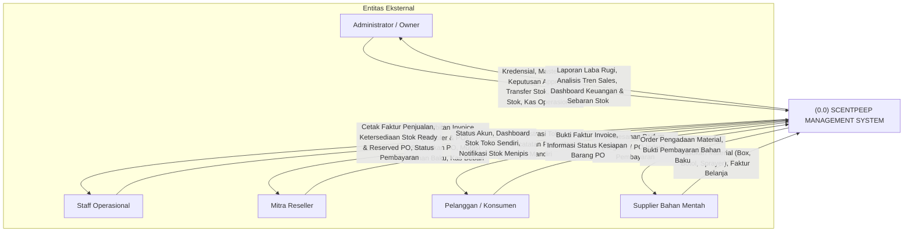
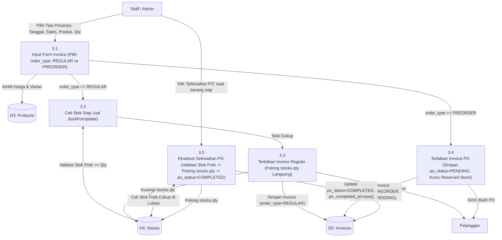
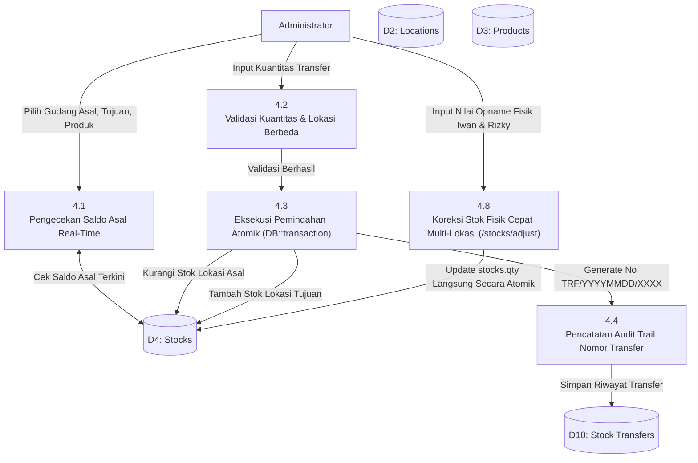
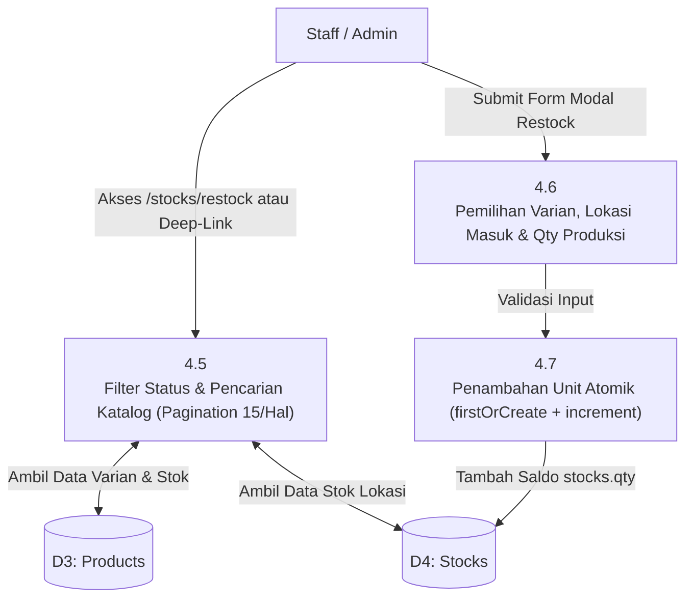
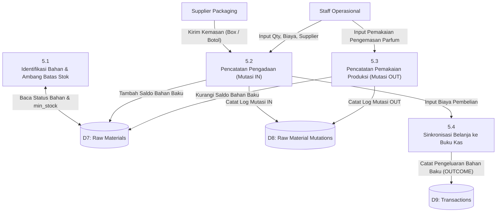

# Data Flow Diagram (DFD) — Scentpeep Management System

Dokumentasi diagram aliran data (*Data Flow Diagram* / DFD) Scentpeep Management System untuk menggambarkan transformasi data dari entitas eksternal, proses bisnis internal, hingga penyimpanan data (*data store*) per rilis **v3.2**.

---

## 1. Diagram Konteks (DFD Level 0)

Diagram Konteks menggambarkan batasan sistem (*system boundary*) secara makro yang menghubungkan sistem utama dengan lima entitas luar (*external entities*).

---

## 2. DFD Level 1 (Dekomposisi Proses Utama)

DFD Level 1 menjabarkan sistem ke dalam 7 proses utama dan 10 penyimpanan data (*data store*), mencerminkan integrasi Pre-Order ke dalam modul Invoice:

```mermaid
flowchart TD
    %% Entitas
    Admin["Administrator"]
    Staff["Staff Operasional"]
    Reseller["Mitra Reseller"]
    Customer["Pelanggan"]
    Supplier["Supplier"]

    %% Data Stores
    D1[("D1: Data Pengguna (users)")]
    D2[("D2: Master Lokasi (locations)")]
    D3[("D3: Master Produk (products)")]
    D4[("D4: Persediaan Stok Fisik (stocks)")]
    D5[("D5: Penjualan & PO Invoice (invoices)")]
    D6[("D6: Pelanggan Tetap (customers)")]
    D7[("D7: Bahan Mentah (raw_materials & categories)")]
    D8[("D8: Mutasi Bahan (raw_material_mutations)")]
    D9[("D9: Buku Kas (transactions)")]
    D10[("D10: Transfer Stok (stock_transfers)")]

    %% Proses 1.0: Autentikasi & Akun
    P1["1.0<br>Autentikasi & Kelola Pengguna"]
    Admin -->|"Konfigurasi User & Approval"| P1
    Reseller -->|"Pendaftaran Akun Baru"| P1
    P1 <-->|"Data User & Hak Akses"| D1
    P1 -->|"Pemetaan Toko Reseller"| D2

    %% Proses 2.0: Master Data
    P2["2.0<br>Manajemen Master Data & Pelanggan"]
    Admin -->|"Input Produk & Lokasi"| P2
    Staff -->|"Tambah Pelanggan Tetap via Combobox"| P2
    P2 <-->|"Simpan / Update Produk"| D3
    P2 <-->|"Simpan / Update Lokasi"| D2
    P2 <-->|"Kelola Kategori Bahan"| D7
    P2 <-->|"Kelola Master Pelanggan"| D6

    %% Proses 3.0: Penjualan & Siklus Invoice (Reguler & PO)
    P3["3.0<br>Penerbitan Invoice & Siklus PO"]
    Staff -->|"Data Pesanan: Reguler / PO Inden"| P3
    Admin -->|"Kelola, Edit & Batalkan Invoice"| P3
    Customer -->|"Order & Pembayaran"| P3
    P3 -->|"Cek Stok Siap Jual (Fisik - Reserved)"| D4
    P3 -->|"Potong Stok Fisik (Order Reguler)"| D4
    P3 <-->|"Simpan Invoice (order_type, po_status)"| D5
    P3 -->|"Faktur Invoice"| Customer

    %% Proses 4.0: Manajemen Stok, Restock & Koreksi
    P4["4.0<br>Manajemen Stok, Restock & Koreksi"]
    Admin -->|"Eksekusi Transfer & Koreksi Cepat"| P4
    Staff -->|"Tambah Stok Produksi (Restock)"| P4
    P4 <-->|"Update Saldo Unit Fisik (qty)"| D4
    P4 <-->|"Simpan Audit Transfer"| D10

    %% Proses 5.0: Pengadaan Bahan Mentah
    P5["5.0<br>Logistik & Mutasi Bahan Mentah"]
    Staff -->|"Pencatatan Mutasi IN/OUT"| P5
    Supplier -->|"Pengiriman Barang Baku"| P5
    P5 <-->|"Update Saldo Fisik Bahan"| D7
    P5 <-->|"Simpan Riwayat Mutasi"| D8
    P5 -->|"Sinkronisasi Biaya Belanja"| D9

    %% Proses 6.0: Buku Kas & Keuangan Operasional
    P6["6.0<br>Pembukuan Kas Operasional"]
    Staff -->|"Input Beban Operasional"| P6
    Admin -->|"Kelola Pos Pengeluaran"| P6
    P6 <-->|"Catat Arus Masuk & Keluar"| D9

    %% Proses 7.0: Pelaporan & Analisis
    P7["7.0<br>Pelaporan & Dashboard Analitik"]
    D4 -.->|"Data Stok Fisik & Siap Jual"| P7
    D5 -.->|"Volume, Omset & Reserved PO"| P7
    D7 -.->|"Stok Box & Botol"| P7
    D9 -.->|"Arus Kas Masuk/Keluar"| P7
    P7 -->|"Dashboard Tren & Ekspor Excel/PDF"| Admin
    P7 -->|"Ringkasan Stok & Cetak Laporan"| Staff
    P7 -->|"Katalog Ketersediaan Publik"| Reseller
```

---

## 3. DFD Level 2

### 3.1 Dekomposisi Proses 3.0: Penjualan & Siklus Invoice (Reguler & PO)

### 3.2 Dekomposisi Proses 4.0: Transfer Stok & Koreksi Stok Cepat

### 3.3 Dekomposisi Proses 4.5: Tambah Stock Produksi (Manual Restock)

### 3.4 Dekomposisi Proses 5.0: Pengadaan & Logistik Bahan Mentah

---

## 4. Kamus Aliran Data (Data Flow Dictionary)

| Nama Aliran Data | Sumber | Tujuan | Struktur / Atribut Utama |
|---|---|---|---|
| **Data Kredensial & Registrasi** | Calon Reseller | P1.0 | Nama, Email, Password Terenkripsi, Nama Toko Reseller |
| **Data Master Produk** | Administrator | P2.0 | Nama Varian, SKU Code, Harga Modal, Harga Jual, Status Aktif |
| **Data Invoice Penjualan (Reguler)** | Staff / Admin | P3.0 | No Invoice, Tanggal, Sales, Pelanggan, Produk, Qty, Total Harga, Lokasi Stok, `order_type=REGULAR`, Status Bayar |
| **Data Pre-Order Inden** | Staff / Admin | P3.0 | No Invoice, Tanggal, Sales, Pelanggan, Produk, Qty, Total Harga, Lokasi Target, `order_type=PREORDER`, `po_status=PENDING` |
| **Aksi Penyelesaian PO** | Staff / Admin | P3.0 | ID Invoice PO, Verifikasi Ketersediaan Stok Fisik, Timestamp `po_completed_at` |
| **Mutasi Stok Fisik** | P3.0 / P4.0 | D4 (stocks) | `location_id`, `product_id`, `qty` penambahan / pemotongan / penyesuaian |
| **Data Koreksi Stok Fisik** | Administrator | P4.0 | `product_id`, `location_id`, `new_qty` |
| **Data Logistik Bahan Mentah** | Staff | P5.0 | Material ID, Tipe Mutasi (`IN`/`OUT`), Qty, Nominal Biaya, Nama Supplier, Catatan |
| **Data Kas Masuk & Keluar** | Staff / Admin | D9 (transactions) | Tanggal, Tipe (`INCOME`/`OUTCOME`), Kategori Pos Kas, Deskripsi, Jumlah Uang, Status Efek Stok (`NONE`) |
| **Laporan & Dokumen Ekspor** | P7.0 | Admin / Publik | File CSV UTF-8 BOM, Dokumen PDF Siap Cetak, Grafik Visual Analitik |
