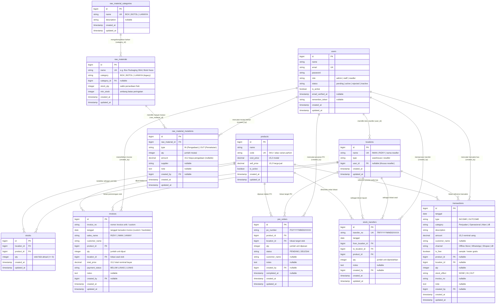

# Entity-Relationship Diagram (ERD) — Scentpeep Management System

Dokumentasi rancangan basis data relasional Scentpeep Management System yang diturunkan langsung dari skema migrasi database aktual (Laravel 12 / MariaDB / MySQL).

---

## 1. Diagram Relasi Entitas (Mermaid ERD)

---

## 2. Kamus Data & Relasi Tabel (Data Dictionary)

### 2.1 Entitas Pengguna & Akses (`users`)
Menyimpan kredensial autentikasi pengguna dan pemetaan peran.
- `id` (BigInt, PK, Auto Increment)
- `name` (VarChar 255): Nama lengkap pengguna.
- `email` (VarChar 255, Unique): Alamat surel unik untuk autentikasi.
- `password` (VarChar 255): Hash kata sandi terenkripsi (Bcrypt).
- `role` (VarChar 50): Hak akses (`admin`, `staff`, `reseller`).
- `status` (VarChar 50): Status persetujuan akun (`pending`, `active`, `rejected`, `inactive`).
- `is_active` (Boolean): Flag penentu hak masuk ke dalam aplikasi.

### 2.2 Entitas Master Lokasi Stok (`locations`)
Menyimpan lokasi fisik penyimpanan inventori parfum.
- `id` (BigInt, PK, Auto Increment)
- `name` (VarChar 255, Unique): Identitas lokasi (contoh: `IWAN`, `RIZKY`, `MAMA EGI`).
- `type` (VarChar 50): Tipe lokasi (`warehouse` untuk gudang utama, `reseller` untuk mitra konsinyasi).
- `user_id` (BigInt, FK ke `users.id`, Nullable): Relasi khusus kepemilikan akun bagi mitra reseller.

### 2.3 Entitas Master Produk Parfum (`products`)
Menyimpan katalog varian parfum Scentpeep.
- `id` (BigInt, PK, Auto Increment)
- `name` (VarChar 255): Nama varian parfum (contoh: `Eros`, `1 Million Lucky`, `Aqua`).
- `code` (VarChar 50, Unique): Kode SKU unik varian.
- `cost_price` (Decimal 15,2): Harga pokok modal per botol.
- `sell_price` (Decimal 15,2): Harga banderol jual standar ke konsumen.
- `is_active` (Boolean): Status aktif penjualan produk.

### 2.4 Entitas Persediaan Fisik Parfum (`stocks`)
Menyimpan saldo inventori aktual per varian di setiap lokasi fisik.
- `id` (BigInt, PK, Auto Increment)
- `location_id` (BigInt, FK ke `locations.id`): Lokasi penyimpanan.
- `product_id` (BigInt, FK ke `products.id`): Varian parfum.
- `qty` (Integer): Jumlah unit botol parfum fisik ready (dilindungi validasi `qty >= 0`).
- *Index Unique*: Komposit `(location_id, product_id)`.

### 2.5 Entitas Penjualan Parfum (`invoices`)
Menyimpan transaksi resmi penjualan parfum per varian ke pelanggan.
- `id` (BigInt, PK, Auto Increment)
- `invoice_no` (VarChar 100, Indexed): Nomor faktur invoice penjualan (custom/otomatis).
- `tanggal` (Date, Indexed): Tanggal transaksi penjualan (dapat di-custom/backdate oleh staf/admin).
- `sales_name` (VarChar 100, Indexed): Nama sales yang memproses (`RIZKY`, `IWAN`, `VANNY`, dsb.).
- `customer_name` (VarChar 255, Indexed): Nama pembeli/pelanggan.
- `product_id` (BigInt, FK ke `products.id`): Varian parfum yang dibeli.
- `qty` (Integer): Jumlah unit botol yang dipotong langsung dari stok lokasi.
- `location_id` (BigInt, FK ke `locations.id`): Lokasi asal pemotongan stok.
- `total_price` (Decimal 15,2): Nilai total transaksi setelah penyesuaian harga/diskon.
- `payment_status` (VarChar 20, Indexed): Status piutang (`BELUM LUNAS` / `LUNAS`).
- `notes` (Text, Nullable): Catatan pesanan.
- `created_by` (BigInt, FK ke `users.id`, Nullable): Pengguna pencatat transaksi.

> **Catatan Pemisahan Kas & Invoice**: Penerbitan atau pelunasan invoice memotong persediaan stok fisik secara atomik, namun status `LUNAS` dan `BELUM LUNAS` murni berfungsi sebagai penanda operasional piutang penjualan. Nominal kas fisik tidak otomatis dimasukkan ke buku kas (`transactions`), melainkan diinput secara manual oleh kasir/admin saat uang benar-benar diterima di rekening/kas utama.

### 2.6 Entitas Pre-Order & Stok Pending (`pre_orders`)
Menyimpan antrean pesanan inden yang belum tersedia secara fisik.
- `id` (BigInt, PK, Auto Increment)
- `po_number` (VarChar 100, Indexed): Nomor referensi PO (`PO/YYYYMMDD/XXXX`).
- `product_id` (BigInt, FK ke `products.id`): Varian parfum yang diproduksi.
- `location_id` (BigInt, FK ke `locations.id`): Lokasi target penambahan stok setelah selesai.
- `qty` (Integer): Jumlah unit yang sedang dalam proses produksi.
- `status` (VarChar 20, Indexed): Status pengerjaan (`PENDING` atau `SELESAI`).
- `customer_name` (VarChar 255, Nullable): Nama pemesan.
- `completed_at` (Timestamp, Nullable): Waktu penyelesaian PO dan penggabungan ke stok utama.
- `created_by` (BigInt, FK ke `users.id`, Nullable): Pembuat baris PO.

### 2.7 Entitas Kategori Bahan Mentah (`raw_material_categories`)
Menyimpan taksonomi dinamis untuk bahan penunjang packaging.
- `id` (BigInt, PK, Auto Increment)
- `name` (VarChar 255, Unique): Nama kategori (contoh: `BOX`, `BOTOL`, `LAINNYA`).
- `description` (VarChar 255, Nullable): Penjelasan material.

### 2.8 Entitas Master Bahan Mentah (`raw_materials`)
Menyimpan inventori material packaging parfum (box, botol, stiker, seal).
- `id` (BigInt, PK, Auto Increment)
- `name` (VarChar 255, Unique): Nama material (contoh: `Box Packaging 30ml`).
- `category` (VarChar 30): Kategori teks legacy.
- `category_id` (BigInt, FK ke `raw_material_categories.id`, Nullable): Relasi kategori dinamis.
- `stock_qty` (Integer): Jumlah saldo fisik material.
- `min_stock` (Integer): Ambang batas peringatan stok menipis.

### 2.9 Entitas Mutasi Logistik Bahan Mentah (`raw_material_mutations`)
Mencatat riwayat logistik pengadaan dan pemakaian bahan mentah (lengkap dengan CRUD).
- `id` (BigInt, PK, Auto Increment)
- `raw_material_id` (BigInt, FK ke `raw_materials.id`): Bahan baku terkait.
- `type` (VarChar 10, Indexed): Arah mutasi (`IN` untuk pengadaan, `OUT` untuk pemakaian produksi).
- `qty` (Integer): Kuantitas material yang masuk atau keluar.
- `amount` (Decimal 15,2, Nullable): Biaya belanja pengadaan (dapat disinkronkan ke buku kas).
- `supplier` (VarChar 255, Nullable): Nama vendor/pemasok bahan baku.
- `note` (Text, Nullable): Catatan mutasi pengadaan atau keperluan produksi.
- `created_by` (BigInt, FK ke `users.id`, Nullable): Staf/admin pencatat.

### 2.10 Entitas Transfer Stok Antar Lokasi (`stock_transfers`)
Menyimpan riwayat perpindahan unit parfum antar lokasi atau ke reseller.
- `id` (BigInt, PK, Auto Increment)
- `transfer_no` (VarChar 100, Unique): Nomor bukti transfer (`TRF/YYYYMMDD/XXXX`).
- `tanggal` (Date): Tanggal eksekusi perpindahan barang.
- `from_location_id` (BigInt, FK ke `locations.id`): Lokasi asal pengirim barang.
- `to_location_id` (BigInt, FK ke `locations.id`): Lokasi penerima barang.
- `product_id` (BigInt, FK ke `products.id`): Varian parfum yang dipindahkan.
- `qty` (Integer): Kuantitas unit yang ditransfer.
- `notes` (Text, Nullable): Keterangan tujuan transfer.
- `created_by` (BigInt, FK ke `users.id`, Nullable): Eksekutor transfer stok.

### 2.11 Entitas Buku Kas & Keuangan (`transactions`)
Menyimpan buku besar kas masuk dan kas keluar operasional bisnis.
- `id` (BigInt, PK, Auto Increment)
- `tanggal` (Date): Tanggal transaksi kas.
- `type` (VarChar 10, Indexed): `INCOME` (Pemasukan) atau `OUTCOME` (Pengeluaran).
- `category` (VarChar 100): Kategori pos kas (Penjualan, Iklan Shopee, Entertain, Bahan Baku, Operasional).
- `description` (VarChar 255): Rincian keterangan transaksi.
- `amount` (Decimal 15,2): Nilai nominal rupiah.
- `customer_name` (VarChar 255, Nullable): Pihak pembeli/rekanan.
- `channel` (VarChar 100, Nullable): Saluran distribusi.
- `is_free` (Boolean): Flag tester/sampel (Rp 0).
- `stock_effect` (VarChar 10): Efek mutasi stok (`NONE`, `IN`, `OUT`).
- `invoice_no` (VarChar 100, Nullable): Tautan referensi nomor invoice penjualan.
- `created_by` (BigInt, FK ke `users.id`, Nullable): Pencatat transaksi.
