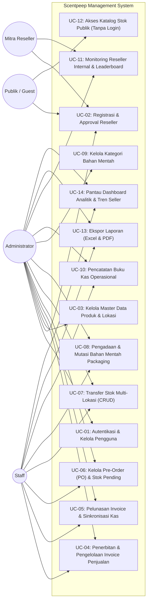

# Use Case Diagram & Spesifikasi Use Case — Scentpeep Management System

Dokumentasi diagram use case dan spesifikasi skenario interaksi sistem Scentpeep Management System.

---

## 1. Diagram Use Case (Mermaid)

---

## 2. Definisi Aktor

| Aktor | Tipe | Deskripsi Peran |
|---|---|---|
| **Administrator** | Manusia | Pemilik usaha (*owner* `Rizky` & `Iwan`) dengan kontrol penuh atas operasional, hak akses pengguna, master produk, persetujuan reseller, audit transfer stok, dan laporan keuangan. |
| **Staff Operasional** | Manusia | Tim administrasi harian yang bertugas menerbitkan invoice penjualan, memproses pesanan pre-order, menginput logistik bahan mentah, mencatat kas beban usaha, dan mengeksekusi transfer barang. |
| **Mitra Reseller** | Manusia | Partner konsinyasi toko yang mendaftar mandiri via web, mengelola ketersediaan unit di tokonya sendiri, dan memantau stok kritis. |
| **Publik / Pelanggan** | Manusia | Pengguna internet dan calon pembeli yang mengakses katalog ketersediaan parfum ready stock dan antrean PO tanpa perlu login. |

---

## 3. Matriks Daftar Use Case

| Kode | Nama Use Case | Aktor Utama | Deskripsi Singkat |
|---|---|---|---|
| **UC-01** | Autentikasi & Kelola Pengguna | Admin | Login, logout, dan manajemen akun staf/admin. |
| **UC-02** | Registrasi & Approval Reseller | Reseller, Admin | Pendaftaran akun reseller mandiri dan verifikasi/persetujuan oleh admin. |
| **UC-03** | Kelola Master Data | Admin | CRUD varian produk parfum (harga modal/jual, SKU) dan lokasi gudang/toko. |
| **UC-04** | Penerbitan Invoice Penjualan | Admin, Staff | Menerbitkan faktur penjualan per varian dengan pemotongan stok fisik atomik. |
| **UC-05** | Pelunasan Invoice & Sinkronisasi Kas | Admin, Staff | Menandai invoice lunas dan otomatis mencatat penerimaan uang di buku kas. |
| **UC-06** | Kelola Pre-Order (PO) | Admin, Staff | Mencatat pesanan inden dan memasukkannya ke stok utama saat selesai. |
| **UC-07** | Transfer Stok Multi-Lokasi | Admin, Staff | Memindahkan stok fisik antar gudang/reseller dengan nomor bukti `TRF/YYYYMMDD/XXXX`. |
| **UC-08** | Mutasi Bahan Mentah Packaging | Admin, Staff | Mencatat logistik pengadaan (IN) box/botol dan pemakaian produksi (OUT). |
| **UC-09** | Kelola Kategori Bahan Mentah | Admin | Mengelola taksonomi material (BOX, BOTOL, LAINNYA, atau kategori kustom). |
| **UC-10** | Pencatatan Buku Kas Operasional | Admin, Staff | Mencatat beban usaha operasional (iklan, gaji, entertain, utilitas). |
| **UC-11** | Monitoring Reseller Internal | Admin, Staff, Reseller | Dashboard komparasi ketersediaan stok fisik per mitra dan varian habis. |
| **UC-12** | Akses Katalog Publik | Publik / Guest | Melihat stok parfum ready dan antrean PO tanpa ekspos margin keuangan. |
| **UC-13** | Ekspor Laporan | Admin, Staff | Mengunduh berkas laporan dalam format Excel (.csv UTF-8 BOM) dan cetak PDF. |
| **UC-14** | Pantau Dashboard Analitik | Admin, Staff | Memantau grafik tren penjualan multi-seller 6 bulan dan donut chart stok. |

---

## 4. Skenario Use Case Terpilih

### 4.1 Skenario UC-04: Penerbitan Invoice Penjualan
- **Aktor**: Administrator, Staff Operasional.
- **Prekondisi**: Pengguna telah terautentikasi dan memiliki stok parfum fisik di lokasi asal.
- **Alur Utama**:
  1. Pengguna membuka menu *Penjualan (Invoice)* dan menekan tombol `+ Buat Invoice`.
  2. Sistem menampilkan formulir pembuatan invoice.
  3. Pengguna memilih sales (`RIZKY`, `IWAN`, atau `VANNY`), mengisi nama pelanggan, memilih varian parfum, lokasi asal stok, kuantitas, total harga, dan status pembayaran.
  4. Pengguna menekan tombol `Simpan & Terbitkan Invoice`.
  5. Sistem memulai transaksi basis data (`DB::transaction`).
  6. Sistem mengunci baris stok terkait dengan `lockForUpdate()` dan memeriksa sisa unit.
  7. Jika stok mencukupi, sistem memotong `stocks.qty` dan menyimpan data invoice.
  8. Jika status pembayaran dipilih `LUNAS`, sistem otomatis mencatat pemasukan kas di tabel `transactions`.
  9. Sistem melakukan commit basis data dan mengarahkan pengguna kembali ke daftar invoice dengan notifikasi sukses.
- **Alur Alternatif**:
  - *Stok Fisik Tidak Mencukupi*: Sistem membatalkan transaksi (`DB::rollBack()`), mempertahankan data formulir, dan menampilkan pesan peringatan error bahwa unit di lokasi tersebut tidak cukup.

### 4.2 Skenario UC-07: Transfer Stok Antar Lokasi
- **Aktor**: Administrator, Staff Operasional.
- **Prekondisi**: Stok di lokasi gudang asal bertatus ready (`qty > 0`).
- **Alur Utama**:
  1. Pengguna membuka menu *Transfer Stok* dan mengklik tombol `+ Transfer Baru`.
  2. Sistem memuat formulir kalkulator transfer stok.
  3. Pengguna memilih lokasi asal; sistem memuat sisa unit fisik riil secara dinamis.
  4. Pengguna memilih lokasi tujuan (lokasi asal otomatis dinonaktifkan dari daftar pilihan tujuan), memilih varian parfum, kuantitas transfer, dan catatan.
  5. Pengguna menekan tombol `Proses Transfer Stok`.
  6. Sistem menjalankan `DB::transaction`, memotong saldo lokasi asal, menambah saldo lokasi tujuan via `firstOrCreate() + increment()`, dan menerbitkan nomor referensi unik `TRF/YYYYMMDD/XXXX`.
  7. Sistem melakukan commit dan menampilkan log audit transfer baru.

### 4.3 Skenario UC-08: Pengadaan & Pemakaian Bahan Mentah Packaging
- **Aktor**: Administrator, Staff Operasional.
- **Prekondisi**: Master bahan mentah telah terdaftar pada sistem.
- **Alur Utama (Pengadaan / IN)**:
  1. Pengguna membuka menu *Bahan Mentah* dan mengklik `+ Catat Pengadaan (IN)`.
  2. Pengguna memilih nama bahan (misal: *Box Packaging 30ml*), kuantitas masuk, nominal biaya belanja, nama supplier, dan catatan faktur.
  3. Pengguna mencentang opsi "Sinkronisasi ke Pengeluaran Kas" (jika dibiayai kas perusahaan).
  4. Sistem menambah saldo `raw_materials.stock_qty`, mencatat log mutasi `IN`, dan membuat baris pengeluaran pada `transactions`.
  5. Pengguna menerima konfirmasi keberhasilan mutasi persediaan material.
