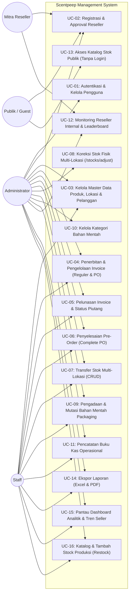

# Use Case Diagram & Spesifikasi Use Case — Scentpeep Management System

Dokumentasi diagram use case dan spesifikasi skenario interaksi sistem Scentpeep Management System per rilis **v3.2**.

---

## 1. Diagram Use Case (Mermaid)

---

## 2. Definisi Aktor

| Aktor | Tipe | Deskripsi Peran |
|---|---|---|
| **Administrator** | Manusia | Pemilik usaha (*owner* `Rizky` & `Iwan`) dengan kontrol penuh atas operasional, hak akses pengguna, master produk, persetujuan reseller, koreksi stok fisik gudang, audit transfer stok, dan laporan keuangan. |
| **Staff Operasional** | Manusia | Tim administrasi harian yang bertugas menerbitkan invoice penjualan reguler dan PO, menyelesaikan pesanan PO saat barang siap, menginput logistik bahan mentah, mencatat kas beban usaha, dan mengeksekusi transfer barang. |
| **Mitra Reseller** | Manusia | Partner konsinyasi toko yang mendaftar mandiri via web, mengelola ketersediaan unit di tokonya sendiri, dan memantau stok kritis. |
| **Publik / Pelanggan** | Manusia | Pengguna internet dan calon pembeli yang mengakses katalog ketersediaan parfum ready stock dan antrean PO tanpa perlu login. |

---

## 3. Matriks Daftar Use Case

| Kode | Nama Use Case | Aktor Utama | Deskripsi Singkat |
|---|---|---|---|
| **UC-01** | Autentikasi & Kelola Pengguna | Admin | Login, logout, dan manajemen akun staf/admin/reseller. |
| **UC-02** | Registrasi & Approval Reseller | Reseller, Admin | Pendaftaran akun reseller mandiri dan verifikasi/persetujuan oleh admin. |
| **UC-03** | Kelola Master Data & Pelanggan | Admin, Staff | CRUD varian produk, lokasi gudang, dan penambahan pelanggan tetap via combobox. |
| **UC-04** | Penerbitan Invoice Penjualan (Reguler & PO) | Admin, Staff | Menerbitkan faktur pesanan langsung (potong fisik) atau pesanan inden PO (reserved). |
| **UC-05** | Pelunasan Invoice & Status Piutang | Admin, Staff | Menandai invoice lunas sebagai penanda operasional penerimaan pesanan. |
| **UC-06** | Penyelesaian Pre-Order (Complete PO) | Admin, Staff | Memvalidasi ketersediaan stok fisik gudang dan memotong unit saat serah terima barang PO. |
| **UC-07** | Transfer Stok Multi-Lokasi | Admin, Staff | Memindahkan stok fisik antar gudang/reseller dengan nomor bukti `TRF/YYYYMMDD/XXXX`. |
| **UC-08** | Koreksi Stok Fisik Multi-Lokasi | Admin | Penyesuaian langsung saldo fisik Iwan & Rizky untuk opname berkala via `/stocks/adjust`. |
| **UC-09** | Mutasi Bahan Mentah Packaging | Admin, Staff | Mencatat logistik pengadaan (IN) box/botol dan pemakaian produksi (OUT). |
| **UC-10** | Kelola Kategori Bahan Mentah | Admin | Mengelola taksonomi material (BOX, BOTOL, LAINNYA, atau kategori kustom). |
| **UC-11** | Pencatatan Buku Kas Operasional | Admin, Staff | Mencatat beban usaha operasional (iklan, gaji, entertain, utilitas). |
| **UC-12** | Monitoring Reseller Internal | Admin, Staff, Reseller | Dashboard komparasi ketersediaan stok fisik per mitra dan varian habis. |
| **UC-13** | Akses Katalog Publik | Publik / Guest | Melihat stok parfum ready dan antrean PO tanpa ekspos margin keuangan. |
| **UC-14** | Ekspor Laporan | Admin, Staff | Mengunduh berkas laporan dalam format Excel (.csv UTF-8 BOM) dan cetak PDF. |
| **UC-15** | Pantau Dashboard Analitik | Admin, Staff | Memantau grafik tren penjualan multi-seller 6 bulan dan donut chart stok. |
| **UC-16** | Tambah Stock Produksi (Restock) | Admin, Staff | Memantau katalog ketersediaan (pagination 15 item) dan menambah unit fisik manual hasil produksi. |

---

## 4. Skenario Use Case Terpilih

### 4.1 Skenario UC-04: Penerbitan Invoice Penjualan (Reguler & Pre-Order)
- **Aktor**: Administrator, Staff Operasional.
- **Prekondisi**: Pengguna telah terautentikasi.
- **Alur Utama (Penjualan Langsung / REGULAR)**:
  1. Pengguna membuka menu *Penjualan (Invoice)* dan menekan tombol `+ Buat Invoice`.
  2. Pengguna memilih tipe pesanan **Penjualan Langsung (Reguler)**.
  3. Pengguna memilih tanggal transaksi, sales, memilih/mengetik nama pelanggan, varian parfum, lokasi asal stok, kuantitas, total harga, dan status pembayaran.
  4. Pengguna menekan tombol `Simpan & Terbitkan Invoice`.
  5. Sistem memulai transaksi basis data (`DB::transaction`).
  6. Sistem mengunci baris stok terkait dengan `lockForUpdate()` dan memeriksa sisa unit fisik.
  7. Jika stok mencukupi, sistem memotong `stocks.qty`, menyimpan invoice dengan `order_type = REGULAR`, `po_status = NONE`.
  8. Sistem melakukan commit dan mengarahkan pengguna kembali ke daftar invoice.
- **Alur Alternatif (Pre-Order / Inden / PREORDER)**:
  - Pada langkah 2, pengguna memilih opsi **Pre-Order (PO / Inden)**.
  - Sistem tidak memotong saldo fisik `stocks.qty`, melainkan menyimpan invoice dengan `order_type = PREORDER` dan `po_status = PENDING`.
  - Kuantitas pesanan otomatis dicatat sebagai **Reserved PO** pada perhitungan Smart Reserved Stock.

### 4.2 Skenario UC-06: Penyelesaian Pre-Order (Complete PO)
- **Aktor**: Administrator, Staff Operasional.
- **Prekondisi**: Terdapat invoice dengan `order_type = PREORDER` dan `po_status = PENDING`.
- **Alur Utama**:
  1. Pada tabel Data Invoice Penjualan, pengguna mengklik tombol tab filter `PO Menunggu (Pending)`.
  2. Pada baris invoice pesanan inden yang barang fisiknya telah siap diserahkan ke pelanggan, pengguna menekan tombol `Selesaikan PO`.
  3. Sistem memulai `DB::transaction` dan mengunci stok lokasi terkait via `lockForUpdate()`.
  4. Sistem memeriksa apakah stok fisik saat ini (`stocks.qty`) mencukupi jumlah kuantitas invoice.
  5. Jika cukup, sistem memotong `stocks.qty`, memperbarui `po_status = COMPLETED`, dan mengisi `po_completed_at = now()`.
  6. Sistem melakukan commit dan menampilkan notifikasi sukses serah terima barang PO.
- **Alur Alternatif (Stok Gudang Belum Cukup)**:
  - Jika stok fisik di gudang kurang dari kebutuhan invoice PO, sistem membatalkan transaksi dan menampilkan peringatan: *"Stok fisik belum mencukupi untuk serah terima barang PO ini. Silakan lakukan Restock terlebih dahulu."*

### 4.3 Skenario UC-08: Koreksi Stok Fisik Multi-Lokasi
- **Aktor**: Administrator.
- **Prekondisi**: Administrator login dan membuka menu *Ringkasan Stok* (`/stocks`).
- **Alur Utama**:
  1. Administrator menekan tombol `Koreksi Stok` pada baris varian parfum.
  2. Sistem menampilkan modal penyesuaian stok fisik dengan nilai saldo aktual lokasi `IWAN` dan `RIZKY`.
  3. Administrator menginputkan jumlah fisik riil hasil opname gudang.
  4. Administrator menekan `Simpan Koreksi Stok`.
  5. Sistem menjalankan `DB::transaction`, memvalidasi angka non-negatif, dan memperbarui `stocks.qty` di masing-masing lokasi.
  6. Halaman me-refresh dengan saldo persediaan fisik baru.
